# Database Documentation — Data Flow Diagrams (DFD)

## Module: User Registration & Authentication

This section documents the Data Flow Diagrams (DFDs) for the **User Registration & Authentication** module, covering functional requirements **FR-1.1 through FR-1.9**. The diagrams are presented in increasing levels of detail: Context Diagram (Level 0), Level 1 (main processes), and Level 2 (decomposition of key processes).

---

### 1. Context Diagram (Level 0)

**Purpose:** Establishes the system boundary by showing the module as a single process interacting with external entities, without exposing internal structure.

**External Entities:**

- **User** — the sole external entity interacting with this module at this stage.

**Process:**

- **0: User Registration & Authentication System**

**Data Flows:**

| Direction | Flow | Related FR |
|---|---|---|
| User → System | Registration details (full name, email, username, password, DOB, country) | FR-1.1 |
| System → User | Registration confirmation / validation or uniqueness error | FR-1.2, FR-1.3 |
| User → System | Login credentials (identifier + password) | FR-1.5 |
| System → User | JWT (on success) / generic authentication error | FR-1.6, FR-1.7 |
| User → System | Protected request carrying JWT | FR-1.9 |
| System → User | Authorized response / 401 authorization error | FR-1.9 |

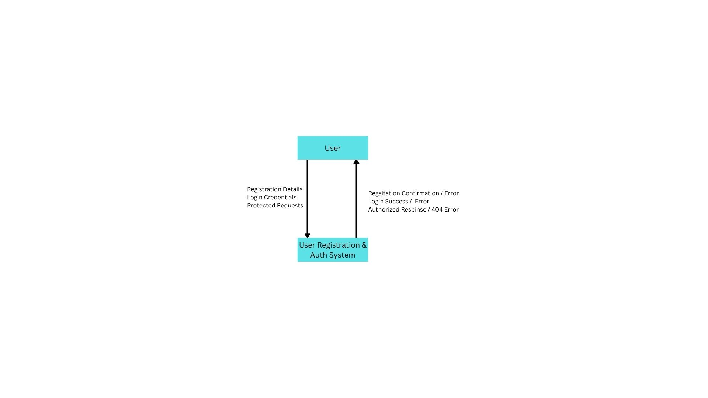

---

### 2. Level 1 DFD — Main Processes

**Purpose:** Decomposes the single context process into the major functional processes of the module, and introduces the data store(s) required to support them.

**Processes:**

| ID | Process Name | Covers |
|---|---|---|
| 1 | Register User | FR-1.1 – FR-1.4 |
| 2 | Authenticate User (Login) | FR-1.5 – FR-1.8 |
| 3 | Authorize Request | FR-1.9 |

**Data Stores:**

| ID | Store Name | Contents |
|---|---|---|
| D1 | Users | Full name, email, username, password hash, date of birth, country |

> **Note:** Only one data store is defined at this stage. No session or refresh-token store is introduced, since JWTs are stateless (FR-1.6) and refresh token functionality is explicitly out of scope (FR-1.8).

**Data Flows:**

| From | To | Flow Description | Related FR |
|---|---|---|---|
| User | 1 (Register User) | Registration form data | FR-1.1 |
| 1 | D1 | New user record (with hashed password) | FR-1.1, FR-1.4 |
| 1 | User | Registration success / validation or uniqueness error | FR-1.2, FR-1.3 |
| User | 2 (Authenticate User) | Login identifier (username or email) + password | FR-1.5 |
| 2 | D1 | Lookup user by identifier | FR-1.5 |
| D1 | 2 | Stored user record (incl. password hash) | FR-1.5 |
| 2 | User | JWT (on success) / generic authentication error | FR-1.6, FR-1.7 |
| User | 3 (Authorize Request) | Protected request + JWT | FR-1.9 |
| 3 | User / Protected Resource | Authorized pass-through, or 401 error | FR-1.9 |

---

### 3. Level 2 DFD — Decomposition of Process 1: Register User

**Purpose:** Breaks down the registration process into its logical sub-steps, reflecting the required order of operations: input validation must precede uniqueness checking, which must precede password hashing, which must precede persistence.

**Sub-processes:**

| ID | Sub-process | Description | Related FR |
|---|---|---|---|
| 1.1 | Validate Input Format | Checks required fields are non-empty, email format is valid, password meets minimum strength | FR-1.3 |
| 1.2 | Check Uniqueness | Verifies email and username do not already exist in D1 | FR-1.2 |
| 1.3 | Hash Password | Converts plaintext password to a secure hash; plaintext is discarded | FR-1.4 |
| 1.4 | Create User Record | Persists the validated, unique, hashed record into D1 | FR-1.1, FR-1.4 |

**Data Flows:**

| From | To | Flow Description |
|---|---|---|
| User | 1.1 | Raw registration data |
| 1.1 | 1.2 | Validated data (or terminates with validation error to User) |
| 1.2 | D1 | Query existing usernames/emails |
| D1 | 1.2 | Existing records for comparison |
| 1.2 | 1.3 | Data cleared as unique (or terminates with uniqueness error to User) |
| 1.3 | 1.4 | Data with password hash (plaintext not forwarded) |
| 1.4 | D1 | Write new user record |
| 1.4 | User | Registration success confirmation |

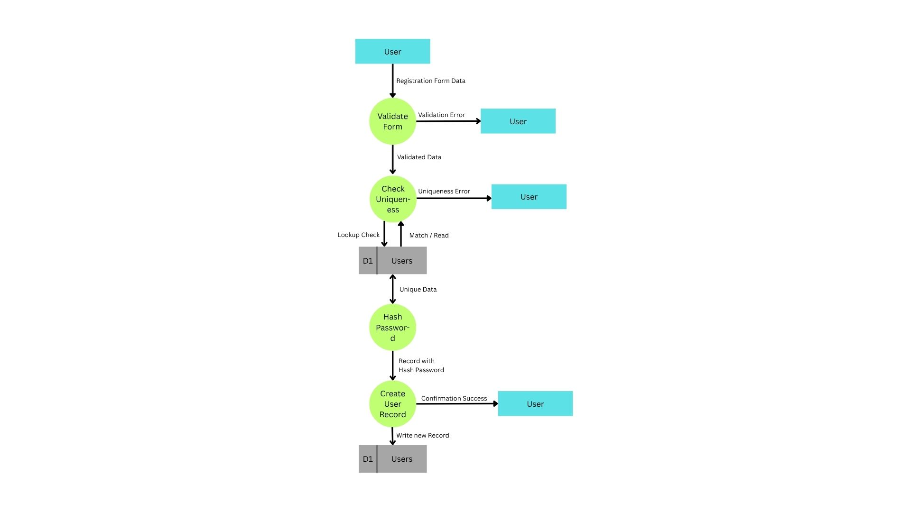

---

### 4. Level 2 DFD — Decomposition of Process 2: Authenticate User

**Purpose:** Breaks down login into lookup, verification, and token issuance, with a single unified error path to satisfy FR-1.7's requirement that failures not reveal which credential was incorrect.

**Sub-processes:**

| ID | Sub-process | Description | Related FR |
|---|---|---|---|
| 2.1 | Lookup User | Finds a user record by submitted username or email | FR-1.5 |
| 2.2 | Verify Password | Compares submitted password against the stored hash | FR-1.4, FR-1.7 |
| 2.3 | Issue JWT | Generates a signed JWT with a fixed expiry | FR-1.6, FR-1.8 |

**Data Flows:**

| From | To | Flow Description |
|---|---|---|
| User | 2.1 | Identifier (username or email) + password |
| 2.1 | D1 | Query by identifier |
| D1 | 2.1 | Matching record (if found) |
| 2.1 | 2.2 | User record + submitted password (on match found) |
| 2.1 | *Authentication Error* | Triggered if no matching record is found |
| 2.2 | 2.3 | Verified credentials (on password match) |
| 2.2 | *Authentication Error* | Triggered if password does not match |
| 2.3 | User | Issued JWT |

> **Design note:** The two error paths (unknown identifier, incorrect password) converge into a single generic **Authentication Error** output, in compliance with FR-1.7.

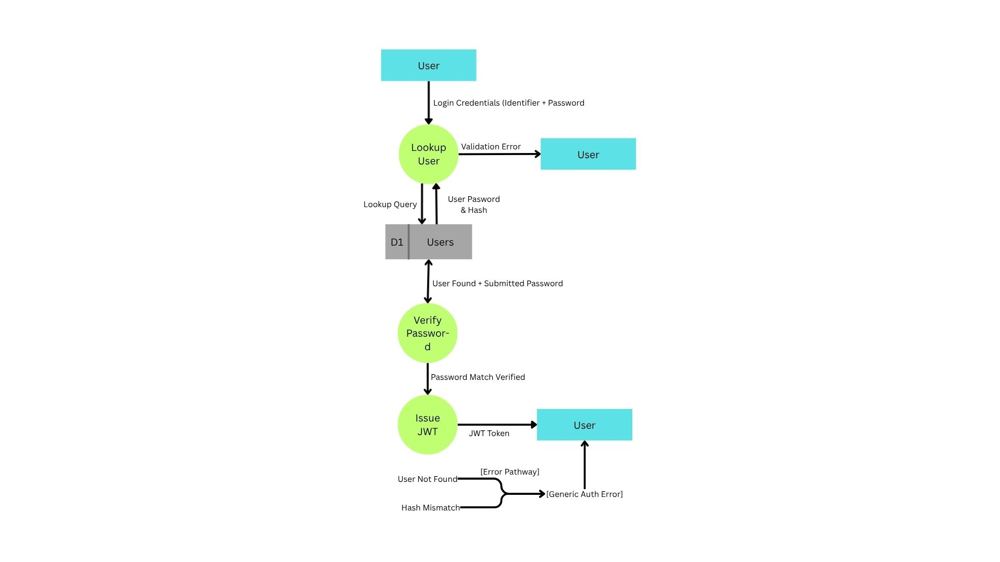

---

### 5. Process 3: Authorize Request

**Note:** Process 3 (Authorize Request) is not further decomposed at Level 2. FR-1.9 describes a single atomic validation step (check JWT presence, validity, and expiry), which does not contain enough distinct sub-behavior to warrant further decomposition without introducing redundant, non-informative sub-processes.

---

## Module: Group Creation & Membership

This section documents the DFDs for the **Group Creation & Membership** module, covering **FR-2.1 through FR-2.7**.

---

### 1. Context Diagram (Level 0)

**External Entities:**

- **User** — specifically an *authenticated* user (this module depends on a valid JWT from the Auth module).

**Process:**

- **0: Group Creation & Membership Management**

**Data Flows:**

| Direction | Flow | Related FR |
|---|---|---|
| User → System | Group creation details (name, description, currency) | FR-2.1 |
| System → User | Group created confirmation | FR-2.1, FR-2.2 |
| User → System | Add-member request | FR-2.3 |
| User → System | Remove-member / Leave-group / Delete-group request | FR-2.5, FR-2.6, FR-2.7 |
| System → User | Membership updated confirmation, or rejection error (non-zero balance) | FR-2.5, FR-2.6, FR-2.7 |

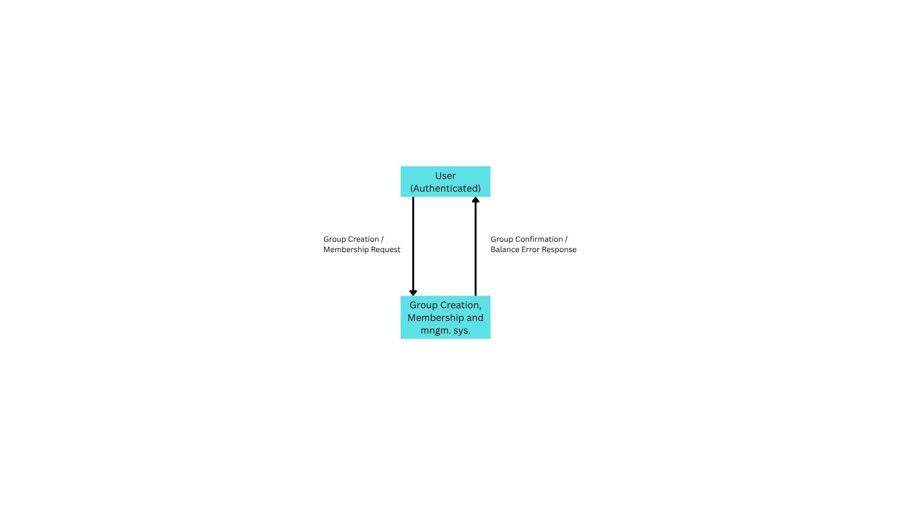

---

### 2. Level 1 DFD — Main Processes

**Processes:**

| ID | Process Name | Covers |
|---|---|---|
| 1 | Create Group | FR-2.1, FR-2.2 |
| 2 | Add Member | FR-2.3, FR-2.4 |
| 3 | Verify Zero Balance | Shared precondition for FR-2.5, FR-2.6, FR-2.7 |
| 4 | Remove Member | FR-2.5 |
| 5 | Leave Group | FR-2.6 |
| 6 | Delete Group | FR-2.7 |

> **Design note:** Processes 4, 5, and 6 all share the identical precondition — "net balance with every other relevant member is zero" — so this logic is isolated into a single reusable Process 3, rather than duplicated three times.

**Data Stores:**

| ID | Store Name | Contents | Owning Module |
|---|---|---|---|
| D2 | Groups | groupId, name, description, currency | This module |
| D3 | GroupMembers | groupId (FK), userId (FK) | This module |
| D1 | Users | *(referenced only)* | Users & Security module |

**Data Flows:**

| From | To | Flow Description | Related FR |
|---|---|---|---|
| User | 1 | Group details (name, description, currency) | FR-2.1 |
| 1 | D2 | New group record | FR-2.1 |
| 1 | D3 | Creator added as first member | FR-2.2 |
| User | 2 | Add-member request (target userId) | FR-2.3 |
| 2 | D1 | Verify target user exists | FR-2.3 |
| 2 | D3 | New membership record | FR-2.3, FR-2.4 |
| User | 4 / 5 / 6 | Remove / Leave / Delete request | FR-2.5 / 2.6 / 2.7 |
| 4 / 5 / 6 | 3 | Invoke balance check, scoped appropriately | — |
| 3 | *Expense/Settlement data (external)* | Query balances (cross-module dependency) | FR-2.5–2.7 |
| 3 | 4 / 5 / 6 | Zero-balance confirmed / violation detected | — |
| 4 / 5 / 6 | D3 (or D2 for deletion) | Remove membership record(s) / group record | — |
| 4 / 5 / 6 | User | Success confirmation / rejection error | FR-2.5, FR-2.6, FR-2.7 |

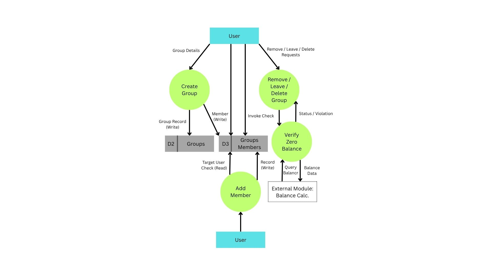

---

### 3. Level 2 DFD — Decomposition of Process 3: Verify Zero Balance

**Purpose:** This is the only process in the module with genuine internal logic and a cross-module data dependency, so it is the only one decomposed further.

**Sub-processes:**

| ID | Sub-process | Description |
|---|---|---|
| 3.1 | Identify Member Pairs | Determines which pairwise comparisons are needed (one member vs. rest, or every pair, depending on caller) |
| 3.2 | Compute Net Balance Per Pair | Nets expense-share and settlement amounts per pair — reuses the same logic defined in the Balance Calculation module (FR-4.1, FR-4.2); not a separate computation |
| 3.3 | Evaluate Zero-Balance Condition | Checks if all relevant pairs equal zero; returns pass/fail |

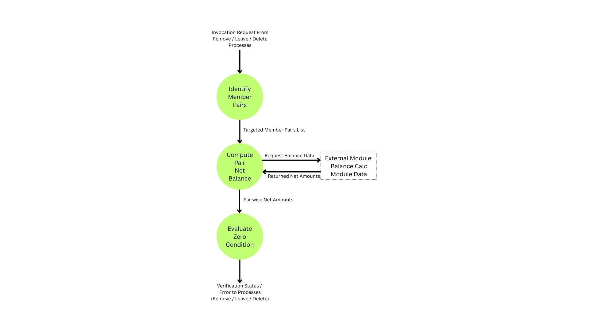

---

### 4. Processes 1, 2, 4, 5, 6 — not further decomposed

**Note:** These processes are each a single atomic operation at Level 1 (capture input, validate, write/remove a record). Further decomposition would only relabel the same step without adding clarity.

---

## Module: Expense Creation & Splitting

This section documents the DFDs for the **Expense Creation & Splitting** module, covering **FR-3.1 through FR-3.8**.

---

### 1. Context Diagram (Level 0)

**External Entities:**

- **User** — an authenticated member of the relevant group (depends on both the Auth and Group Membership modules).

**Process:**

- **0: Expense Creation & Splitting**

**Data Flows:**

| Direction | Flow | Related FR |
|---|---|---|
| User → System | New expense details (title, amount, date, payer, participants, split type, split inputs) | FR-3.1–FR-3.5 |
| System → User | Expense recorded confirmation / validation error | FR-3.1, FR-3.4 |
| User → System | Edit/delete expense request | FR-3.6 |
| System → User | Edit/delete confirmation or error | FR-3.6 |

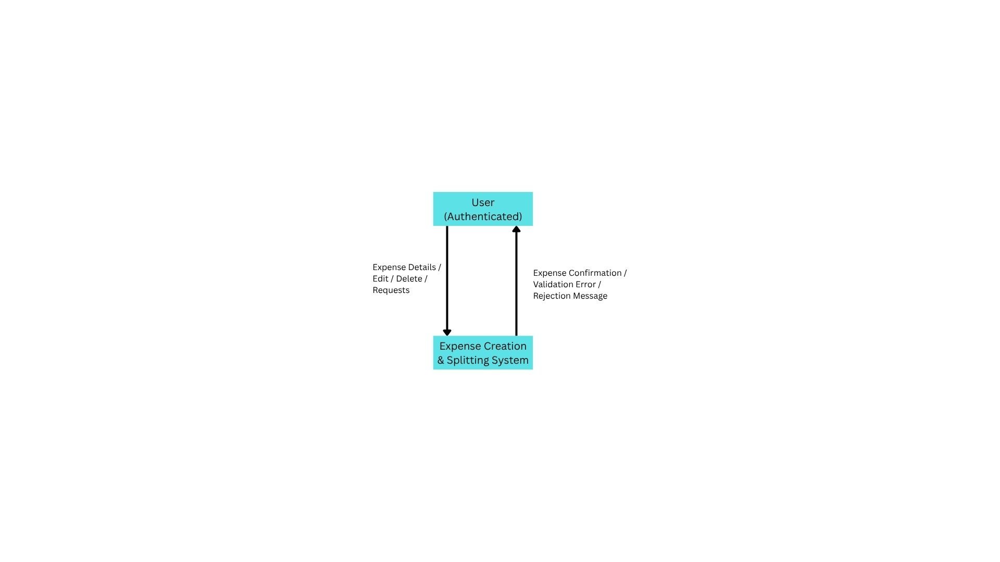

---

### 2. Level 1 DFD — Main Processes

**Processes:**

| ID | Process Name | Covers |
|---|---|---|
| 1 | Add Expense | FR-3.1, FR-3.2, FR-3.3, FR-3.7 |
| 2 | Compute Split | FR-3.4, FR-3.5, FR-3.8 |
| 3 | Edit/Delete Expense | FR-3.6 |

**Data Stores:**

| ID | Store Name | Contents | Owning Module |
|---|---|---|---|
| D4 | Expenses | expenseId, groupId (FK), title, amount, date, payerId (FK) | This module |
| D5 | ExpenseSplits | expenseId (FK), userId (FK), shareAmount | This module |
| D2 | Groups | *(referenced for currency)* | Group module |
| D3 | GroupMembers | *(referenced to validate payer/participants)* | Group module |

**Data Flows:**

| From | To | Flow Description | Related FR |
|---|---|---|---|
| User | 1 | Expense details: title, amount, date, payer, participant list | FR-3.1, FR-3.2 |
| 1 | D3 | Verify payer and participants are group members | FR-3.2, FR-3.3, FR-3.5 |
| 1 | D2 | Fetch group's currency | FR-3.7 |
| 1 | 2 | Amount + participant list + split type + split inputs | FR-3.4, FR-3.5 |
| 2 | D5 | Write computed per-participant shares | FR-3.8 |
| 1 | D4 | Write expense record | FR-3.1 |
| 2 | 1 / User | Validation error (percentages ≠ 100%, exact amounts ≠ total) | FR-3.4 |
| 1 | User | Expense recorded confirmation | FR-3.1 |
| User | 3 | Edit/delete request (expenseId) | FR-3.6 |
| 3 | D3 | Verify requester is any member of the group | FR-3.6 |
| 3 | 2 | Recompute split (on edit affecting amount/participants/type) | FR-3.6 |
| 3 | D4, D5 | Update or delete expense + associated splits | FR-3.6 |
| 3 | User | Confirmation or error | FR-3.6 |

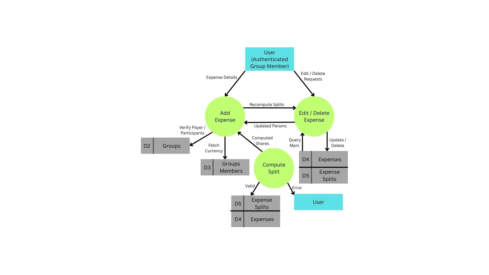

---

### 3. Level 2 DFD — Decomposition of Process 2: Compute Split

**Purpose:** This process contains three genuinely distinct algorithms plus a remainder-handling edge case, warranting decomposition.

**Sub-processes:**

| ID | Sub-process | Description | Related FR |
|---|---|---|---|
| 2.1 | Determine Split Type | Routes to the correct split algorithm | FR-3.4 |
| 2.2 | Compute Equal Split | Divides amount evenly; assigns remainder to payer | FR-3.4 (equal), FR-3.8 |
| 2.3 | Compute Percentage Split | Applies percentages; validates sum = 100% | FR-3.4 (percentage) |
| 2.4 | Compute Exact Amount Split | Applies exact amounts; validates sum = total | FR-3.4 (exact) |

**Data Flows:**

| From | To | Flow Description |
|---|---|---|
| 1 | 2.1 | Amount, participant list, split type, split inputs |
| 2.1 | 2.2 / 2.3 / 2.4 | Routed based on split type |
| 2.2 / 2.3 / 2.4 | D5 | Write final per-participant shareAmount records |
| 2.3 / 2.4 | 1 / User | Validation error if sums don't reconcile |

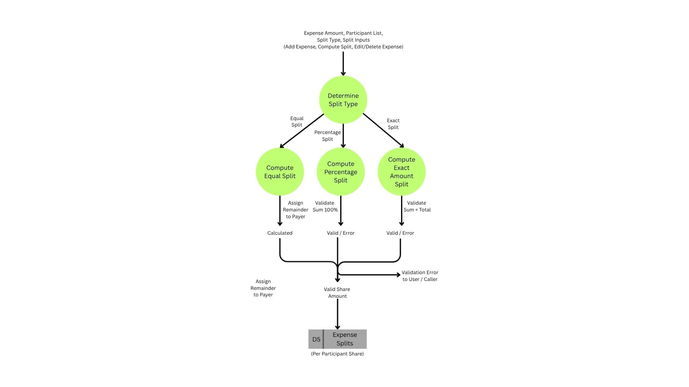

---

### 4. Process 1, 3 — not further decomposed

**Note:** Add Expense and Edit/Delete Expense are each single atomic operations once Compute Split is factored out; no further decomposition adds clarity.

---

## Module: Balance Calculation

This section documents the DFDs for the **Balance Calculation** module, covering **FR-4.1 through FR-4.5**.

> **Note:** Unlike every other module, this one introduces **no new data store**. Per FR-4.4, balances are computed on-demand, never persisted — this module's role is purely to *read and derive*, not to own state.

---

### 1. Context Diagram (Level 0)

**External Entities:**

- **User** — one of the two parties whose balance is being viewed (relevant to the FR-4.5 visibility rule).

**Process:**

- **0: Balance Calculation**

**Data Flows:**

| Direction | Flow | Related FR |
|---|---|---|
| User → System | Balance query request (scope: per-group or total) | FR-4.1 |
| System → User | List of directional balance entries (e.g., "A owes B $50 from Expense X") | FR-4.3 |

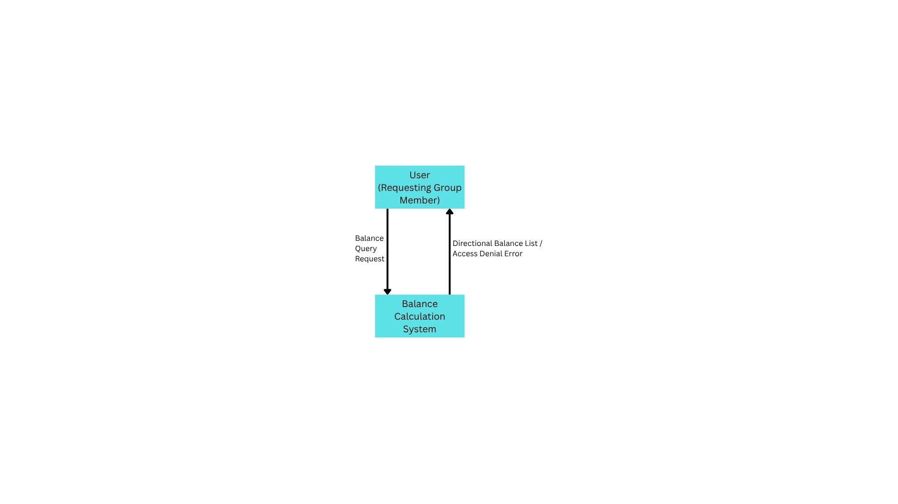

---

### 2. Level 1 DFD — Main Processes

**Processes:**

| ID | Process Name | Covers |
|---|---|---|
| 1 | Determine Query Scope | Resolves per-group vs. total, and the two users involved | FR-4.1 |
| 2 | Enforce Visibility Rule | Confirms requester is one of the two parties | FR-4.5 |
| 3 | Aggregate Expense Shares | Pulls unpaid share amounts from ExpenseSplits | FR-4.2 |
| 4 | Aggregate Settlements | Pulls recorded settlement amounts | FR-4.2 |
| 5 | Compile Directional Balances | Combines 3 and 4 into separate directional entries (not netted) | FR-4.3 |

**Data Stores (all referenced, none owned by this module):**

| ID | Store | Referenced For | Owning Module |
|---|---|---|---|
| D3 | GroupMembers | Shared-group lookup for "total balance" scope | Group module |
| D4 | Expenses | Payer identity, to determine share direction | Expense module |
| D5 | ExpenseSplits | Share amounts per participant | Expense module |
| D6 | Settlements | Recorded settlement amounts | Settlements module (defined next) |

**Data Flows:**

| From | To | Flow Description | Related FR |
|---|---|---|---|
| User | 1 | Balance query (two users, scope: group or total) | FR-4.1 |
| 1 | 2 | Resolved scope + involved parties | — |
| 2 | D3 | Confirm shared group membership | FR-4.5 |
| 2 | 3, 4 | Authorized query (or terminates with access error) | FR-4.5 |
| 3 | D5, D4 | Read expense shares + payer info | FR-4.2 |
| 4 | D6 | Read settlement records | FR-4.2 |
| 3 | 5 | Expense-derived directional amounts | — |
| 4 | 5 | Settlement-derived directional amounts | — |
| 5 | User | Directional balance list | FR-4.3 |

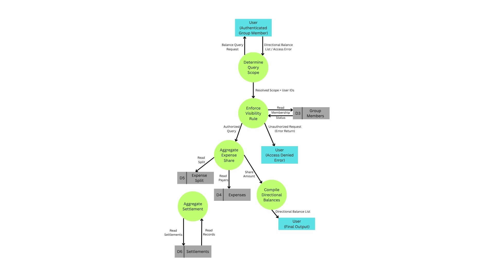

---

### 3. Level 2 decomposition — not needed

**Note:** Each process here (scope resolution, visibility check, two read-aggregations, compilation) is already atomic at Level 1.

---

## Module: Settlements

This section documents the DFDs for the **Settlements** module, covering **FR-5.1 through FR-5.5**.

---

### 1. Context Diagram (Level 0)

**External Entities:**

- **User** — either payer or receiver (FR-5.4 allows either party to record it).

**Process:**

- **0: Settlement Recording**

**Data Flows:**

| Direction | Flow | Related FR |
|---|---|---|
| User → System | Settlement details (payer, receiver, amount, date, optional note, group) | FR-5.1, FR-5.2 |
| System → User | Settlement recorded confirmation / rejection error (exceeds outstanding balance) | FR-5.3, FR-5.4 |

**Note:** No edit/delete flow exists at this boundary — FR-5.5 makes settlements immutable, so only a create direction is modeled, in deliberate contrast to the Expense module.

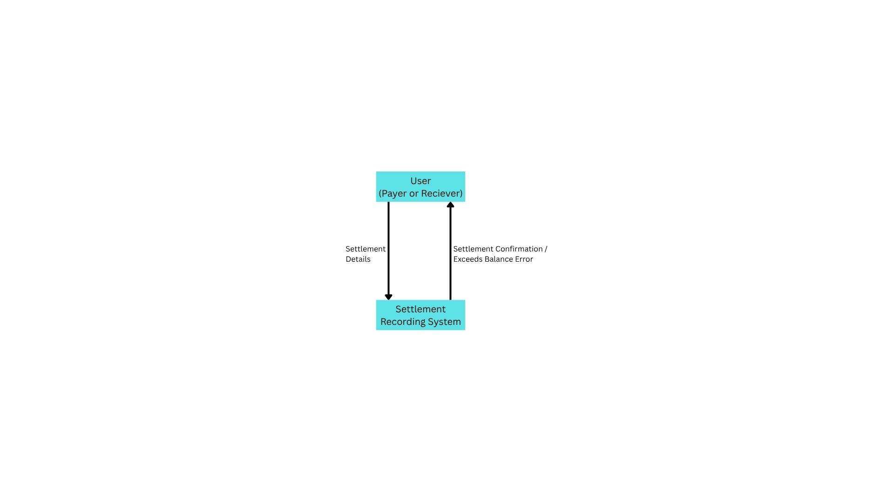

---

### 2. Level 1 DFD — Main Processes

**Processes:**

| ID | Process Name | Covers |
|---|---|---|
| 1 | Validate Settlement Amount | Checks amount doesn't exceed outstanding balance | FR-5.3 |
| 2 | Record Settlement | Persists the settlement record | FR-5.1, FR-5.2, FR-5.4 |

> **Note:** No third process exists for FR-5.5 (immutability). This requirement is satisfied by the deliberate *absence* of any update/delete process, not by an additional process.

**Data Stores:**

| ID | Store Name | Contents | Owning Module |
|---|---|---|---|
| D6 | Settlements | settlementId, groupId (FK), payerId (FK), receiverId (FK), amount, date, note | This module |

**Data Flows:**

| From | To | Flow Description | Related FR |
|---|---|---|---|
| User | 1 | Settlement details: payer, receiver, amount, date, group, note | FR-5.1, FR-5.2 |
| 1 | *Balance Calculation (external, Process 5)* | Request current outstanding balance, scoped to group/pair | FR-5.3, reuses FR-4.1–4.3 |
| *Balance Calculation* | 1 | Outstanding balance figure | — |
| 1 | 2 | Validated settlement data (or terminates with error) | FR-5.3 |
| 2 | D6 | Write new settlement record | FR-5.1, FR-5.2 |
| 2 | User | Settlement recorded confirmation | FR-5.4 |

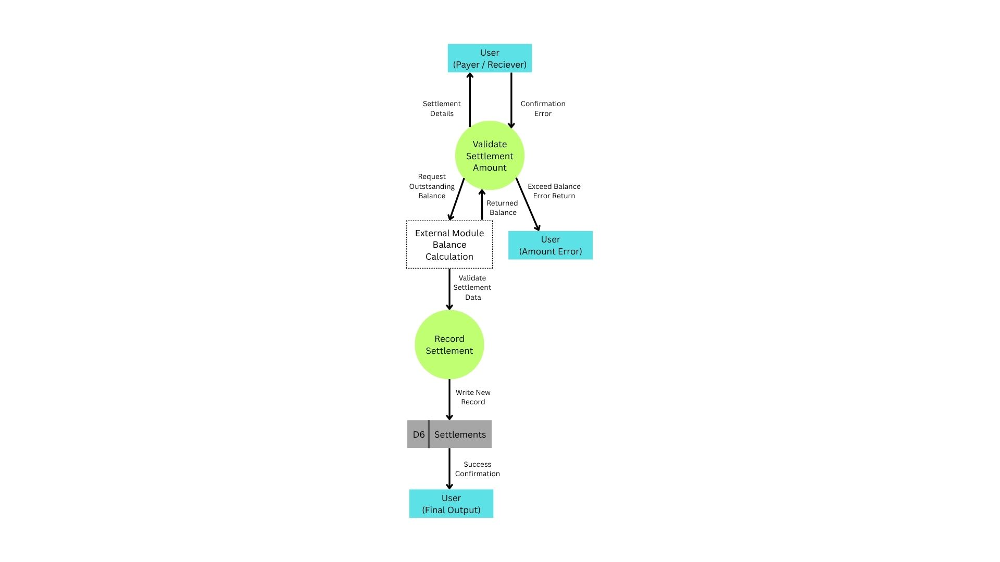

---

### 3. Level 2 decomposition — not needed

**Note:** Both processes are already atomic at Level 1, same reasoning as Balance Calculation.

---

### Data Store Index (All Modules)

| ID | Store | Owning Module |
|---|---|---|
| D1 | Users | Users & Security |
| D2 | Groups | Group Creation & Membership |
| D3 | GroupMembers | Group Creation & Membership |
| D4 | Expenses | Expense Creation & Splitting |
| D5 | ExpenseSplits | Expense Creation & Splitting |
| D6 | Settlements | Settlements |

### Diagram Numbering & Balancing Notes

- Each data store (D1–D6) is numbered consistently across every level and module in which it appears, as required for DFD balancing.
- Every flow entering or leaving a decomposed process at Level 2 corresponds to a flow on that same process at Level 1 (no flows are introduced or dropped during decomposition).
- Cross-module data flows (e.g., Group module reading D1, Balance Calculation reading D3/D4/D5/D6) are documented explicitly rather than left implicit, since these modules were diagrammed independently but share underlying data.
- Processes with no internally distinct sub-steps (e.g., Authorize Request, Balance Calculation's five processes, both Settlement processes) are deliberately left undecomposed at Level 2, to avoid introducing non-informative relabeled steps.

---

## Entity-Relationship Diagram (ERD)

> **Scope note:** This ERD now covers the **full prototype scope** — Users & Security, Group Creation & Membership, Expense Creation & Splitting, Balance Calculation (no entity of its own), and Settlements — based on FR-1.1 through FR-5.5. `Category`, `Role`/`Permission`, refresh tokens, and other explicitly deferred features are excluded, consistent with the project's stated prototype boundaries.

### Entities, Primary Keys, and Attributes

| Entity | Primary Key | Key Attributes | Foreign Keys | Related FR |
|---|---|---|---|---|
| **User** | `userId` (surrogate) | fullName, email (unique), username (unique), passwordHash, dateOfBirth, country, createdAt | — | FR-1.1–1.4 |
| **Group** | `groupId` (surrogate) | name, description, currency, createdAt | — | FR-2.1 |
| **GroupMember** | composite `(groupId, userId)` | joinedAt | groupId → Group, userId → User | FR-2.2–2.4 |
| **Expense** | `expenseId` (surrogate) | title, amount, date, splitType | groupId → Group, payerId → User | FR-3.1–3.3, FR-3.7 |
| **ExpenseSplit** | composite `(expenseId, userId)` | shareAmount | expenseId → Expense, userId → User | FR-3.4, FR-3.5, FR-3.8 |
| **Settlement** | `settlementId` (surrogate) | amount, date, note (optional) | groupId → Group, payerId → User, receiverId → User | FR-5.1, FR-5.2 |

**Reasoning notes carried from design discussion:**
- `GroupMember` and `ExpenseSplit` use **composite keys** because each pairing is inherently unique by the business rule it represents (one membership per user-group pair; one share per user-expense pair).
- `Settlement` uses a **surrogate key** because no natural composite guarantees uniqueness — the same payer/receiver pair can legitimately settle more than once (e.g., two separate payments on different days), so a composite key would wrongly forbid that.
- `Settlement.payerId` and `Settlement.receiverId` are two distinct FK *roles* to the same entity (`User`) and must be labeled distinctly in the diagram (e.g., "pays" / "receives"), not drawn as one generic relationship line.
- `Expense.payerId` references `User` directly, not `GroupMember` — "payer must be a group member" is a semantic/business rule enforced by validation logic, not a structural key constraint.
- No `Balance` entity exists. Per FR-4.4, balances are computed on-demand from `ExpenseSplit` and `Settlement`, never stored.

### Relationships and Cardinalities

| Relationship | Cardinality | Notes |
|---|---|---|
| User — GroupMember | 1:N | One user has many membership records (FR-2.4) |
| Group — GroupMember | 1:N | One group has many members |
| *User —[via GroupMember]— Group* | M:N | Realized through the junction |
| Group — Expense | 1:N | One group has many expenses (FR-3.1) |
| User — Expense (as payer) | 1:N | Labeled "pays"; one user can pay for many expenses (FR-3.3) |
| Expense — ExpenseSplit | 1:N | One expense has many participant shares |
| User — ExpenseSplit | 1:N | One user participates in many splits across expenses |
| *Expense —[via ExpenseSplit]— User* | M:N | Attributed junction — carries `shareAmount` on the relationship itself |
| Group — Settlement | 1:N | Every settlement belongs to exactly one group (FR-5.2) |
| User — Settlement (as payer) | 1:N | Labeled "pays" |
| User — Settlement (as receiver) | 1:N | Labeled "receives" |

### Notation Guidance for Drawing Junctions

`GroupMember` and `ExpenseSplit` should both be drawn as **regular entity rectangles** (Crow's Foot style), not diamonds — this matches how they'll physically exist as tables in MySQL, keeping the ERD and schema visually consistent. Each junction connects to its two parent entities via two separate 1:N lines (crow's-foot "many" toward the junction, single line "one" toward the parent), and each line should be labeled with the verb it represents from the junction's perspective (e.g., `ExpenseSplit` → `Expense`: "splits"; `ExpenseSplit` → `User`: "owed by") rather than a generic "junction to..." label repeated on both sides of the same entity.

### Deliberate Exclusions (Not Modeled)

- `Category` — explicitly deferred from prototype scope.
- `Role` / `Permission` — no role-based access control exists in current FRs.
- `Balance` — computed on-demand (FR-4.4), never persisted.
- Session/Token persistence — JWTs are stateless (FR-1.6, FR-1.8); refresh tokens out of scope.

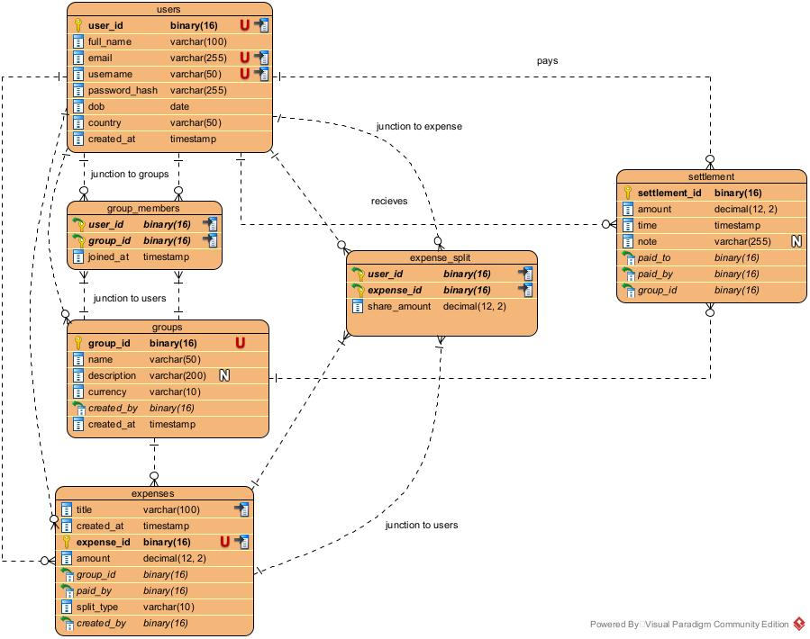

---

## Enhanced ERD (EER)

> **Scope note:** This EER evaluates the full prototype schema (all entities from the unified ERD above) against every EER construct. It is built on top of the ERD rather than replacing it — entities, attributes, and keys are unchanged.

### EER Construct Checklist

| Construct | Applicable? | Reasoning |
|---|---|---|
| Specialization / Generalization | No | No entity varies in attributes or behavior by "kind." `User` is uniform (no Admin/RegularUser distinction exists in any FR). `Expense.splitType` is a **value**, not a structural subtype — all three split types still produce the same `ExpenseSplit` structure (`userId`, `expenseId`, `shareAmount`); only the computation differs, which is a process concern (already captured in the DFD), not a schema concern. |
| Union / Category | No | No entity is a subtype of two or more unrelated supertypes anywhere in the model. |
| Disjoint vs. Overlapping | N/A | Only meaningful if specialization existed; it doesn't. |
| Total vs. Partial Participation | **Yes — the one applicable construct** | See participation constraints below. |

### Participation Constraints

| Relationship | Participation | Reasoning |
|---|---|---|
| `Group` in `GroupMember` | **Total** | A group can never exist with zero members — the creator is automatically added as a member at creation time (FR-2.2). |
| `Expense` in `ExpenseSplit` | **Total** | An expense is only meaningful if split among at least one participant; FR-3.2 defines "the set of group members among whom the expense is split" as part of what constitutes an expense. |
| `User` in `GroupMember` | **Partial** | A user can exist (e.g., immediately after registration) without belonging to any group. |
| `User` in `ExpenseSplit` | **Partial** | A user can exist without having participated in any expense split. |
| `User` in `Settlement` (either role) | **Partial** | A user can exist without having made or received any settlement. |

### Conclusion

No specialization, generalization, union, or category constructs apply anywhere in this schema. The EER is therefore **structurally identical to the ERD** — same entities, attributes, and keys — and differs only in formally marking the total-participation constraints on `Group`→`GroupMember` and `Expense`→`ExpenseSplit` (shown as double-line edges in Crow's Foot notation), which the plain ERD does not visually distinguish from partial participation.

**[Insert EER image here — identical structure to ERD, with total-participation edges marked]**

---

## Semantic Diagram

> **Scope note:** This section formalizes business rules and integrity constraints implied by FR-1.1 through FR-5.5 that are not visually expressible through entity/relationship structure alone. Organized by module, with a cross-cutting section at the end.

### Users & Security

| Rule | Entity / Attribute | Related FR |
|---|---|---|
| Email must be unique across all users | `User.email` | FR-1.2 |
| Username must be unique across all users | `User.username` | FR-1.2 |
| All core fields are mandatory (non-empty) | `User.fullName/email/username/password/dateOfBirth/country` | FR-1.1, FR-1.3 |
| Email must conform to valid format | `User.email` | FR-1.3 |
| Password must meet minimum strength before hashing | `User.passwordHash` (pre-hash input) | FR-1.3 |
| Plaintext password must never be persisted | `User.passwordHash` | FR-1.4 |
| Authentication must identify a user by either username OR email | `User.username`, `User.email` | FR-1.5 |

### Group Creation & Membership

| Rule | Entity / Attribute | Related FR |
|---|---|---|
| A group must have at least one member at all times after creation | `Group` ↔ `GroupMember` | FR-2.2 (also an EER total-participation constraint) |
| A user may belong to multiple groups simultaneously | `GroupMember` | FR-2.4 |
| A member may be removed only if their net balance with every other member of that group is zero | `GroupMember`, derived from `ExpenseSplit`/`Settlement` | FR-2.5 |
| A user may leave a group only if their net balance with every other member is zero | `GroupMember` | FR-2.6 |
| A group may be deleted only if the net balance between every pair of its members is zero | `Group`, derived from `ExpenseSplit`/`Settlement` | FR-2.7 |

### Expense Creation & Splitting

| Rule | Entity / Attribute | Related FR |
|---|---|---|
| `Expense.payerId` must reference a user who is a `GroupMember` of `Expense.groupId` | `Expense.payerId` | FR-3.2, FR-3.3 |
| Every `ExpenseSplit.userId` for a given expense must be a `GroupMember` of that expense's group | `ExpenseSplit.userId` | FR-3.5 |
| For a given expense, the sum of all `ExpenseSplit.shareAmount` values must exactly equal `Expense.amount` | `ExpenseSplit.shareAmount`, `Expense.amount` | FR-3.4, FR-3.8 (sum-consistency constraint — not enforceable via FK/type, must be procedural) |
| An expense's currency is not independently stored — it is always its parent group's currency | `Expense` (derived, not stored), `Group.currency` | FR-3.7 |
| For uneven equal splits, any rounding remainder is assigned to the payer's share | `ExpenseSplit.shareAmount` | FR-3.8 |

### Balance Calculation

| Rule | Entity / Attribute | Related FR |
|---|---|---|
| A balance between two users is derived exclusively from `ExpenseSplit` and `Settlement` — no other source is valid | `ExpenseSplit`, `Settlement` | FR-4.2 |
| Balances must be shown directionally, never collapsed into one net figure | (query-logic rule, not a storage rule) | FR-4.3 |
| A user may only view balances in which they are one of the two involved parties | (access-control rule) | FR-4.5 |

### Settlements

| Rule | Entity / Attribute | Related FR |
|---|---|---|
| `Settlement.amount` must not exceed the current outstanding balance between payer and receiver, scoped to the group | `Settlement.amount` | FR-5.3 |
| A settlement row, once created, is immutable — no update or delete may ever target it | `Settlement` (entire row) | FR-5.5 |

> **Implementation note:** FR-5.5's immutability is currently enforced only by the *absence* of edit/delete functionality at the application layer (per the DFD). If stricter guarantees are wanted, this is a candidate for a database-level enforcement mechanism (e.g., a `BEFORE UPDATE`/`BEFORE DELETE` trigger, or revoking `UPDATE`/`DELETE` privileges on the table) — worth raising as a design option during a viva if asked how this rule is *guaranteed* rather than just assumed.

### Cross-Cutting Rule (Extension Beyond Stated Requirements)

| Rule | Entity / Attribute | Related FR |
|---|---|---|
| Timestamps (`createdAt`, `joinedAt`, `date` fields) are system-generated or set at the time of the action, never retroactively editable | All entities with a timestamp attribute | *Extension* — only FR-5.5 states this explicitly (for Settlements); applied here as a general principle by analogy, not a directly stated requirement for every entity |
