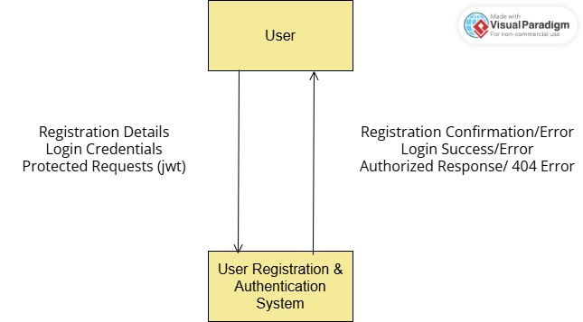
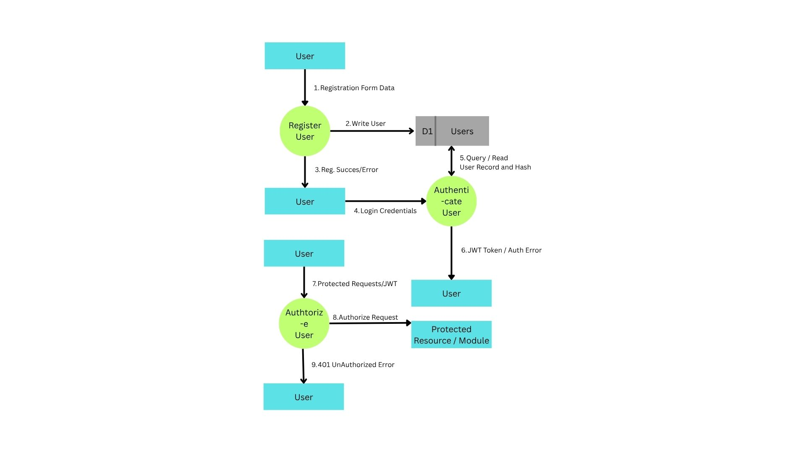

# Database Documentation

## Data Flow Diagrams (DFD)

### Module: User Registration & Authentication

This section documents the Data Flow Diagrams (DFDs) for the **User Registration & Authentication** module, covering functional requirements **FR-1.1 through FR-1.9**. The diagrams are presented in increasing levels of detail: Context Diagram (Level 0), Level 1 (main processes), and Level 2 (decomposition of key processes).

---

#### 1. Context Diagram (Level 0)

**Purpose:** Establishes the system boundary by showing the module as a single process interacting with external entities, without exposing internal structure.

**External Entities:**
- **User** — the sole external entity interacting with this module at this stage.

**Process:**
- **0: User Registration & Authentication System**

**Data Flows:**

| Direction | Flow | Related FR |
|---|---|---|
| User → System | Registration details (full name, email, username, password, DOB, country) | FR-1.1 |
| System → User | Registration confirmation / validation or uniqueness error | FR-1.2, FR-1.3 |
| User → System | Login credentials (identifier + password) | FR-1.5 |
| System → User | JWT (on success) / generic authentication error | FR-1.6, FR-1.7 |
| User → System | Protected request carrying JWT | FR-1.9 |
| System → User | Authorized response / 401 authorization error | FR-1.9 |

---

#### 2. Level 1 DFD — Main Processes

**Purpose:** Decomposes the single context process into the major functional processes of the module, and introduces the data store(s) required to support them.

**Processes:**

| ID | Process Name | Covers |
|---|---|---|
| 1 | Register User | FR-1.1 – FR-1.4 |
| 2 | Authenticate User (Login) | FR-1.5 – FR-1.8 |
| 3 | Authorize Request | FR-1.9 |

**Data Stores:**

| ID | Store Name | Contents |
|---|---|---|
| D1 | Users | Full name, email, username, password hash, date of birth, country |

> **Note:** Only one data store is defined at this stage. No session or refresh-token store is introduced, since JWTs are stateless (FR-1.6) and refresh token functionality is explicitly out of scope (FR-1.8).

**Data Flows:**

| From | To | Flow Description | Related FR |
|---|---|---|---|
| User | 1 (Register User) | Registration form data | FR-1.1 |
| 1 | D1 | New user record (with hashed password) | FR-1.1, FR-1.4 |
| 1 | User | Registration success / validation or uniqueness error | FR-1.2, FR-1.3 |
| User | 2 (Authenticate User) | Login identifier (username or email) + password | FR-1.5 |
| 2 | D1 | Lookup user by identifier | FR-1.5 |
| D1 | 2 | Stored user record (incl. password hash) | FR-1.5 |
| 2 | User | JWT (on success) / generic authentication error | FR-1.6, FR-1.7 |
| User | 3 (Authorize Request) | Protected request + JWT | FR-1.9 |
| 3 | User / Protected Resource | Authorized pass-through, or 401 error | FR-1.9 |

---

#### 3. Level 2 DFD — Decomposition of Process 1: Register User

**Purpose:** Breaks down the registration process into its logical sub-steps, reflecting the required order of operations: input validation must precede uniqueness checking, which must precede password hashing, which must precede persistence.

**Sub-processes:**

| ID | Sub-process | Description | Related FR |
|---|---|---|---|
| 1.1 | Validate Input Format | Checks required fields are non-empty, email format is valid, password meets minimum strength | FR-1.3 |
| 1.2 | Check Uniqueness | Verifies email and username do not already exist in D1 | FR-1.2 |
| 1.3 | Hash Password | Converts plaintext password to a secure hash; plaintext is discarded | FR-1.4 |
| 1.4 | Create User Record | Persists the validated, unique, hashed record into D1 | FR-1.1, FR-1.4 |

**Data Flows:**

| From | To | Flow Description |
|---|---|---|
| User | 1.1 | Raw registration data |
| 1.1 | 1.2 | Validated data (or terminates with validation error to User) |
| 1.2 | D1 | Query existing usernames/emails |
| D1 | 1.2 | Existing records for comparison |
| 1.2 | 1.3 | Data cleared as unique (or terminates with uniqueness error to User) |
| 1.3 | 1.4 | Data with password hash (plaintext not forwarded) |
| 1.4 | D1 | Write new user record |
| 1.4 | User | Registration success confirmation |

---

#### 4. Level 2 DFD — Decomposition of Process 2: Authenticate User

**Purpose:** Breaks down login into lookup, verification, and token issuance, with a single unified error path to satisfy FR-1.7's requirement that failures not reveal which credential was incorrect.

**Sub-processes:**

| ID | Sub-process | Description | Related FR |
|---|---|---|---|
| 2.1 | Lookup User | Finds a user record by submitted username or email | FR-1.5 |
| 2.2 | Verify Password | Compares submitted password against the stored hash | FR-1.4, FR-1.7 |
| 2.3 | Issue JWT | Generates a signed JWT with a fixed expiry | FR-1.6, FR-1.8 |

**Data Flows:**

| From | To | Flow Description |
|---|---|---|
| User | 2.1 | Identifier (username or email) + password |
| 2.1 | D1 | Query by identifier |
| D1 | 2.1 | Matching record (if found) |
| 2.1 | 2.2 | User record + submitted password (on match found) |
| 2.1 | *Authentication Error* | Triggered if no matching record is found |
| 2.2 | 2.3 | Verified credentials (on password match) |
| 2.2 | *Authentication Error* | Triggered if password does not match |
| 2.3 | User | Issued JWT |

> **Design note:** The two error paths (unknown identifier, incorrect password) converge into a single generic **Authentication Error** output, in compliance with FR-1.7.

---

#### 5. Process 3: Authorize Request

**Note:** Process 3 (Authorize Request) is not further decomposed at Level 2. FR-1.9 describes a single atomic validation step (check JWT presence, validity, and expiry), which does not contain enough distinct sub-behavior to warrant further decomposition without introducing redundant, non-informative sub-processes.

---

#### Diagram Numbering & Balancing Notes

- Data store **D1 (Users)** is numbered consistently across all levels, as required for DFD balancing.
- Every flow entering or leaving a decomposed process at Level 2 corresponds to a flow on that same process at Level 1 (no flows are introduced or dropped during decomposition).
- Error/termination flows (validation, uniqueness, authentication errors) are shown explicitly at Level 2 to reflect early-exit behavior, even though Level 1 abstracts them into a single generic "error" flow per process.

## Entity-Relationship Diagram (ERD)

> **Scope note:** This ERD currently models **only the Users & Security module**, based strictly on FR-1.1 – FR-1.9. It is an incremental, module-scoped snapshot and **will be expanded** as subsequent modules (e.g., Expenses, Groups, Payments) are designed. Entities, attributes, and relationships from those future modules — along with their foreign-key connections back to `User` — will be merged into this diagram in later revisions. Until then, this ERD should be read as a **partial, working view** of the overall system's data model, not the final schema.

### Entities in Current Scope

Only one entity is currently justified by the requirements. No `Role`, `Permission`, or `PasswordResetToken` entities are included at this stage, since FR-1.1–FR-1.9 do not describe role-based access control or a password-reset flow — introducing them now would be speculative modeling ahead of requirements.

**Entity: `User`**

| Attribute | Type (conceptual) | Constraints / Notes | Related FR |
|---|---|---|---|
| userId | Identifier | Primary Key | — |
| fullName | Text | Required, non-empty | FR-1.1, FR-1.3 |
| email | Text | Required, unique, valid email format | FR-1.1, FR-1.2, FR-1.3 |
| username | Text | Required, unique | FR-1.1, FR-1.2 |
| passwordHash | Text | Required; stores hash only, never plaintext | FR-1.4 |
| dateOfBirth | Date | Required | FR-1.1 |
| country | Text | Required | FR-1.1 |
| createdAt | Timestamp | System-generated, not user-supplied | — |

### Relationships in Current Scope

None. `User` currently stands alone with no relationships to other entities, since no second entity exists yet within this module's requirements. Login and authorization (FR-1.5–FR-1.9) are behavioral processes (already captured in the DFD) rather than structural relationships, and JWTs are not persisted (stateless per FR-1.6/FR-1.8), so no `Session` or `Token` entity/relationship is modeled.

### Anticipated Future Extensions (not yet modeled)

Listed here for traceability only — these are **not** part of the current diagram and will only be added once their respective modules are designed:

- `Group`, `Expense`, `Payment` entities (from other modules), each expected to have a foreign-key relationship back to `User` (e.g., a User creates/belongs to Groups, a User incurs/pays Expenses).
- Possible `Role`/`Permission` entities, if role-based access control is introduced in a later revision of the Security module's requirements.
- Possible `PasswordResetToken` entity, if a forgot-password flow is added to the Security module's requirements later.

